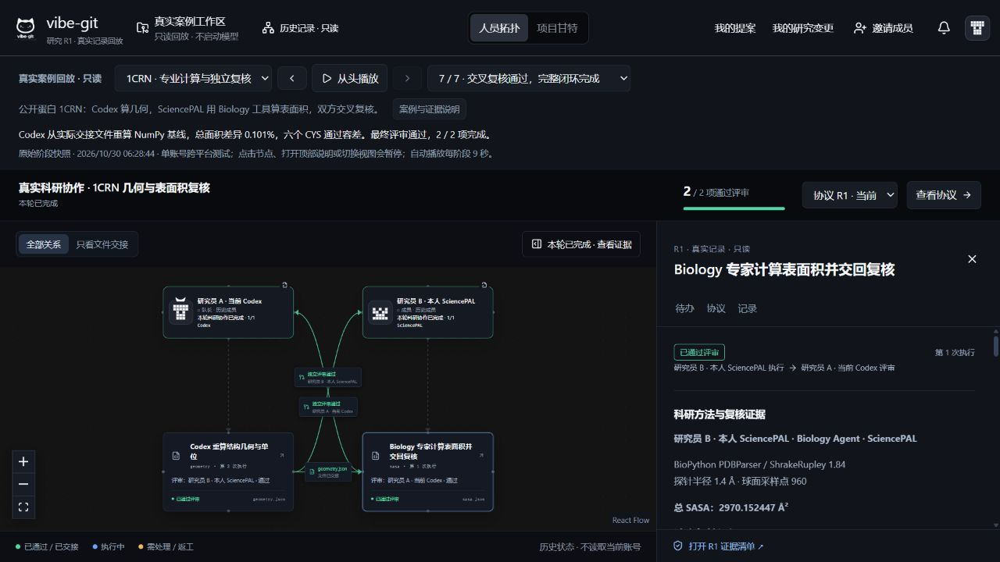

# Vibe-Git Research · 可核查的科研交接

**让 Codex 与 SciencePAL 在同一份研究协议下合作，把经过复核的成果、版本和批准依据一起交给下一步。**

面向已经同时使用 Codex 和 SciencePAL、需要交换计算结果并复核的研究者。一个人管理多个 Agent 也可以使用；多人各用自己的 Agent 是保留的协作能力。平台负责让版本、检查和批准依据随文件交接，减少依赖人记住检查步骤；是否值得配置、是否节省真人操作时间仍待测量。

在队友原 [Vibe-Git](https://github.com/TFboy1/vibe-git) 上扩展，沿用人员拓扑、项目甘特、成员提案和队长发布逻辑。当前只以 **Codex × SciencePAL** 为已实跑主路径。**1CRN 与 Iris 是验证案例**，用户可定义研究问题；当前文件与检查类型限制见下方，不宣称覆盖任意科研流程。

## 三分钟看懂这次增加了什么

科研成员各自在 Agent 中计算时，难点是：数据和方法有没有被改、文件是否已批准、只缺记录要不要重算。原项目已有多人协作与防偏移；我们把这套约束延伸到跨平台科研文件的交接。

| 要核查的价值 | 最新真实案例中发生了什么 |
|---|---|
| SciencePAL 实际做科研 | Biology 环境执行 1CRN SASA 计算，交付 2967.6165 Ų；Codex 独立复核，与预先基准相差约 0.187% |
| 缺证据不必重跑原计算 | 首次缺版本和代码被退回；补齐原运行证据后复审获批，原计算仍只有一次 |
| 只改报告不重复上游工作 | 正式增加中文摘要及限制说明，只重做报告和评审；原计算文件及批准 ID 保持不变 |

先看[真实两轮记录与原始文件](docs/research/LATEST-GOVERNANCE-LIVE-20261031.md)，再看[基础流程视频](https://weihanchen000.github.io/vibe-git-research/submission/watch.html)或[原拓扑历史回放](https://weihanchen000.github.io/vibe-git-research/replay/?case=isolated&step=members)。视频和回放是各自标注的历史轮次，不是最新一轮的连续录像。

这些证据支持“可核查的交接与成果复用”，不代表新生物学发现、算法独占或已证明节省真人时间。新用户从[三步接入与第一轮操作](vibe-git/SCIENCEPAL-QUICKSTART.md)开始。

[本次多 Agent 整合与防漂移说明](docs/research/MULTI-AGENT-INTEGRATION.md) · [完整展示与讲解](docs/research/SHOWCASE.md) · [原版能力对照](docs/research/COMPARISON.md) · [队友三步接入](vibe-git/SCIENCEPAL-QUICKSTART.md) · [架构与扩展](docs/research/ARCHITECTURE.md) · [验证与边界](docs/research/VALIDATION.md) · [全部材料导航](docs/research/INDEX.md)



*实际构建界面的只读历史回放。单个真实 SciencePAL 账号与 Codex，两种工作流身份；不代表两位真实用户已经联调。*

下载后可双击 [`docs/research/index.html`](docs/research/index.html) 查看无需安装的图文展示；GitHub 上请直接阅读上方展示页。

## 黑客松提交材料

[提交包与缺项清单](docs/submission/README.md) · [5 页技术说明](docs/submission/project-brief.pdf) · [▶ 直接播放故事演示（英文配音）](https://weihanchen000.github.io/vibe-git-research/submission/watch.html) · [原创性与资源说明](docs/submission/ORIGINALITY-RESOURCES.md)

材料不等于已经提交。队伍身份、最终声明和问卷回执仍需队长完成；SciencePAL 展示链接的访问状态见提交包。

## 先看，还是直接使用？

| 目的 | 入口 | 是否调用真实模型 |
|---|---|---|
| 发给队友快速了解 | 本 README 与完整展示 | 否 |
| 自己点击真实案例全过程 | [公网原拓扑回放](https://weihanchen000.github.io/vibe-git-research/replay/?case=isolated&step=members)，或 `vibe-git/open-replay.cmd` | 否，使用已保存原始证据 |
| 体验加入、提案、返工与交接 | 构建后 `npm run research:simulate-ui` | 否，明确标记合成演练 |
| 开始自己的研究项目 | 队长 `vibe-git/open-captain.cmd`；成员 `vibe-git/open-research.cmd` | 是，执行时使用各自账号额度 |

要求 **Node.js 24+**。从仓库根目录：

```powershell
cd vibe-git
npm ci
npm run build
npm run research:replay
```

终端输出本机链接，保持终端开启。首次安装需要网络；构建后的回放不需要 API Key。回放可选单机三成员十三阶段、1CRN 七阶段或 Iris 九阶段，能展开原始文件、评审和交接证据。Windows 也可双击 `open-replay.cmd` 自动准备。

## 实际使用的主路径

**加入房间 → 绑定本人 Agent → 写自己的研究提案 → 上传材料并冻结项目 → 对齐与发布 → 按“现在轮到谁”执行 → 评审 / 返工 → 获批文件交接。**

上传自己的材料、选择参与成员、定义自己的方法与验收标准即可建项。当前界面支持单份、不超过 256 KiB 的 UTF-8 CSV / TSV / TXT / JSON / DATA / PDB；它还不是任意格式、大文件的通用数据平台。自定义材料会移除案例专用成果约束。

## 相比原版增加了什么？

| 原版基础（保留） | 科研扩展（新增） |
|---|---|
| 多人 Codex、成员提案、队长对齐与发布 | 同项目中的成员身份与 Codex / SciencePAL 绑定 |
| Git、任务和需求版本 | 冻结科研输入字节、输出格式、来源与验收要求 |
| 原拓扑与任务状态 | 文件交接与独立评审关系、“等谁 / 下一步” |
| 完成确认与已有接口契约 | 研究产物回执、格式门禁、评审退回与重试版本 |
| 软件开发流程 | 科研专家执行、原线程等待输入后接续、证据回放 |

详细对照以原版 **f3e888f** 为基线。界面旧图来自原仓库的交互演示，不冒充原版完整运行评测；六类自动门禁结果也不等于真人效率提升。见 [对照方法及盲点](docs/research/COMPARISON.md)。

## SciencePAL 的必要性怎么体现？

它在本项目中是实际科研执行端：从账号可用 Agent 目录选择专家，接收任务文件，在其环境中执行并交回产物。1CRN 的真实 Biology 运行交付了 BioPython 1.84、计算参数、代码与输出；Codex 在另一端重算核对。平台管理的是这次合作的身份、版本、证据和交接。

这证明当前集成有实际用途，**不证明这些算法只有 SciencePAL 能做**。研究工具可用性与任务适配才是选择它的理由；不能把强制调用它或角色名称当成独特优势证据。

## 当前验证状态

- 最新真实两轮闭环及 31 份附件、34 条回执见 [最新验证记录](docs/research/LATEST-GOVERNANCE-LIVE-20261031.md)；219 项科研专项属于历史单机基线，[早期真实整合记录](docs/research/INTEGRATED-LIVE-20261031.md) 单独保留，不混用文件数与测试数。
- 原有真实案例：1CRN 七阶段、Iris 九阶段，共 **38 个原始附件**；新增单机三成员案例另列于下方，均保留字节数和 SHA256。
- 真实跨平台：一个 SciencePAL 账号 + 本地 Codex 已验证；真实两位用户各自账号联调仍待完成。
- 受控测试：1CRN 首版单位错误与参数确认、Iris 首次数值错误是明示设计；不冒充自然发生的错误。Iris 第二次缺代码为真实产物问题。
- 当前 Codex 可从本人任务入口启动已登录的本地执行器，使用冻结任务包交回；不会接管任意已有会话。其他平台接口已接入，除 Codex / SciencePAL 外真实模型仍待验证。

<details>
<summary>查看历史基线、其他案例与原始验证记录</summary>

### 历史基线与其他验证

历史提交基线为 [`ca1b2b5`](https://github.com/WeihanChen000/vibe-git-research/tree/ca1b2b5227e660559fb9e29c4d69a259252efb54)。后续按原功能保留要求补兼容与防偏移缺口，不新增平台、学科案例或重做界面。

最新代码补齐[科研防偏移与反例验证](docs/research/RESEARCH-ANTI-DRIFT-20261031.md)：原文遗漏不能发布、返工须对应原验收、变更按影响复用有效成果。该新增治理层已通过受控模拟及最新真实两轮闭环；既有回放仍展示其原始历史版本。

- [直接打开原拓扑回放](https://weihanchen000.github.io/vibe-git-research/replay/?case=isolated&step=members)：单机三个成员身份，13 个实际阶段，无需安装或账号。
- [历史单机验收与修复](docs/research/ISOLATED-ACCEPTANCE-20261031.md)：17 项运行检查通过，保留三次退回、补证复审和最终交接；中途需操作者核对原线程，非全自动成功。
- 已冻结输入、参数与验收；数值检查按事先约定的规则执行；获批文件携带绑定到其字节的批准依据。已有参考的质量、容差和科学解释仍由研究者负责。
- [一键验收说明](vibe-git/SCIENCEPAL-ISOLATED-ACCEPTANCE.md)：默认不调用模型，分别运行模拟检查与真实记录离线核验。真实重跑需现有账号和工具环境。

最新补充：[两套新实验的完整流程与使用者验收](docs/research/WORKFLOW-EXPERIMENTS-20261031.md)。传感器标定、反应动力学均完成界面建项、偏移阻断、返工、交接与报告变更；包含实际本地计算、模拟 Agent、可自行操作的演练入口。

</details>

## 来源与团队使用

原功能保留与同学代码覆盖范围见[核对清单](docs/research/ORIGINAL-FUNCTION-PRESERVATION.md)：原软件流程继续保留，科研扩展不替代原防偏移机制；当前主 CLI 的执行仍限于 Codex。

这是公开的团队分享仓库，保留上游基线和作者归属，不改写队友原仓库。源码包包含科研 Skill：[`vibe-git/research-skill`](vibe-git/research-skill/SKILL.md)。原版文档入口为 [README-ORIGINAL.md](README-ORIGINAL.md)，早期研发报告可能描述历史阶段，请以本 README 和验证页为当前状态。

仓库已由负责人授权公开，可直接分享给队友与评委。当前快照未发现统一的根级开源许可证，公开可见不等于授予任意使用许可；保留原作者及素材归属，不擅自补写 MIT。见 [来源和分享范围](docs/research/PROVENANCE.md)。API Key、邀请凭据、成员 token、私人数据库与完整运行目录均不进入分享快照。

## 无需队友配合的验收

- [单机多成员验收与一键命令](vibe-git/SCIENCEPAL-ISOLATED-ACCEPTANCE.md)：默认离线；`--live` 才使用现有账号。
- [直接打开原拓扑只读回放](https://weihanchen000.github.io/vibe-git-research/replay/?case=isolated&step=members)：不需要安装或登录。
- [历史单机验收结果与修复](docs/research/ISOLATED-ACCEPTANCE-20261031.md)。

范围为一个操作者、同一台电脑、独立项目成员身份和工作目录；不宣称真人跨电脑或 SciencePAL 跨账号隔离已验证。

单人使用负担核查：[两条路径的操作步骤与空白记录表](docs/research/manual-handoff-check/README.md)。复用同一成果与检查表，不新增模型调用；尚无真人测量结果。

误操作检查：[坏邀请、错误成果、断线回执、权限与恢复验收](docs/research/HUMAN-ERRORS-20261031.md)。

本轮[评委与首次使用者审阅及修改](docs/research/JUDGE-USER-REVIEW-20261031.md)：突出最新证据、简化确认区阅读、补齐第一轮操作，并支持等待输入时直达本次 SciencePAL 原线程、在运行上限耗尽前说明不能继续的操作；科研专项 289 项和兼容专项 37 项通过。新增恢复检查为受控模拟与组件验证，未当作真人使用测试或新的真实模型运行。
