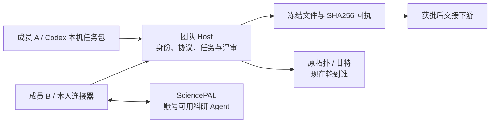

# 通用科研协作的结构

账号归各自成员，本人连接器访问本人 SciencePAL。团队 Host 管理协作协议和成果流，不要求队长收集所有人的 Key。Codex 使用本机任务包；支持平台之间合作不等于已适配所有 Agent。

## 三层职责

| 层 | 位置 | 职责 |
|---|---|---|
| 通用协议 | `vibe-git/packages/protocol/src/sciencepal-*` | 成员、任务、版本、依赖和状态 |
| 执行与门禁 | `vibe-git/apps/host/src/sciencepal/` | 专家目录、连接器、文件、回执、格式、评审和接续 |
| 原界面呈现 | `vibe-git/apps/web/src/sciencepal/` | 拓扑、待办、提案、建项、证据与回放 |
| 可选案例 | `sciencepal-crn-case.ts`、Iris 配置及 fixtures | 特定数据、参数、schema，不定义平台边界 |

源码中的 sciencepal 命名沿用集成起点；它不是只有 1CRN 能运行的限制。真实扩展新平台仍需实现和验证连接器，不能只改 UI 标签。

## 通用证据展示

成果 `result` 可提供 `researchEvidence`，以 `version: 1` 和 `tools / parameters / measurements / limitations` 数组描述实际方法。字段不要求蛋白、SASA 或固定任务键。既有冻结 schema 如果禁止额外字段，必须先在建项时定义协议，不能运行中偷偷添加。

`ScientificEvidence.tsx` 校验产物文件大小与 SHA256 后显示。作者报告的工具和参数与独立复核分开展示。历史 1CRN 输出通过独立兼容适配器转成通用展示结构；主流程不靠 source hash 选择课题。

回放中的独立复算记录还绑定候选哈希与评审产物，只在对应阶段已获批且收集到匹配评审时显示。此记录展示不等于后端具备通用数值验真器。

## 已知约束

目前图形上传是一份 UTF-8 文本文件、不超过 256 KiB。新建界面项目启用治理版本 1：变更逐任务核对影响与指纹、保留原文并追加修订；重新对齐后，未受影响且已批准的成果可验证复用。旧项目仍保留整轮重对齐的兼容路径。变更限于无未收尾运行的阶段边界，尚未移植执行中选择性暂停。详见[科研防偏移验证](RESEARCH-ANTI-DRIFT-20261031.md)。本地 Agent 通过统一执行器或本人任务包入口完成任务，具体平台仍需真实账号验收。大规模团队、长周期生产稳定性、真人双账号尚需专项验证。

队友通用执行器、SciencePAL 适配器与科研门禁的分层见 [本次整合](MULTI-AGENT-INTEGRATION.md)。
