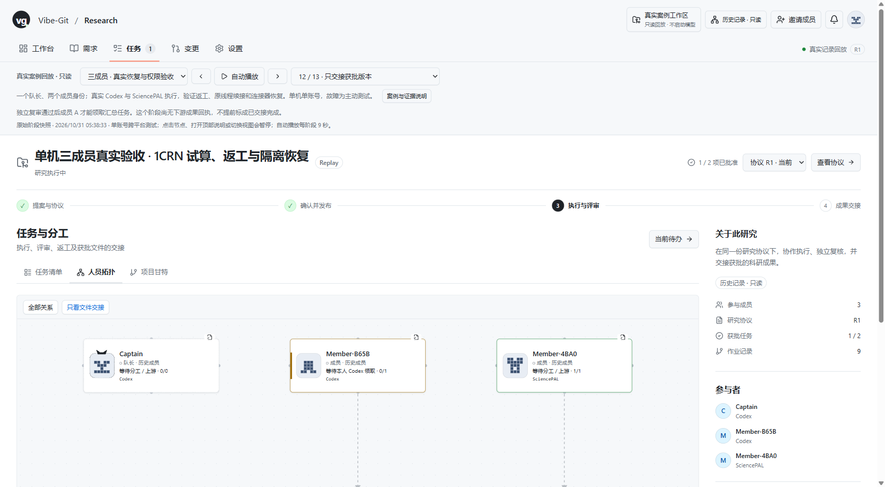

# CityuAI4S 接入审核（2026-10-31）

## 整合来源与界面决定

- 拉取队友 `TFboy1/vibe-git` 的 `CityuAI4S`：`f3088f84c844f5ef7354acbf3cd7e9d2cc32a012`。
- 共同基线为本仓库交接提交 `0a4d67cf9b2bd7ee72076d925df42331462d032f`。新增提交 `1b1e469`、`f3088f8`，保留原作者与完整历史。
- 用户本轮明确选择“采用队友的新工作台界面”。科研界面改以该工作台为基准；原软件界面、人员拓扑、甘特、提案与权限仍须保留。不能继续说科研界面布局与旧版完全一致。
- 本仓库同步整合，不覆盖或推送修改队友的源分支。队友可继续负责最终内容与提交。

## Standards 审核

未发现已确认的新后端权限绕过。恢复本地执行先检查本人任务身份及版本，要求本人确认原进程停止；当前入口仍在执行时拒绝恢复。保留派发标记，不自动重启模型，交回仍需检查和评审。外部进程是否停止依赖本人确认，不能宣称跨进程自动检测。

SciencePAL FAILED 回执恢复核对原运行、领取、负责人和远端身份。重复失败状态仍经过成员和版本检查。初审的界面基准冲突已由用户本轮明确授权解除。

## Spec 审核与修正

发现当前提交清单仍保存旧 README 哈希；现已按 Git 规范字节更新，并为新增 SciencePAL 文件单列清单。旧视频/PDF 的历史检查范围保留，不把新界面或新包冒称已在旧视频展示。

新 SciencePAL 190/192 项结果是历史证据核验，不是重新计算 SASA；已核验外层 ZIP 及八份内层原件的大小和哈希。未重新运行远端 Agent。

## 本轮实际检查

| 检查 | 本轮结果 |
|---|---|
| 原软件兼容 | 40 项通过 |
| 科研与适配器测试 | 310 项通过 |
| 前端组件测试 | 59 项通过；与前述测试有重叠，不相加 |
| 模拟连接器重启及项目隔离 | 1 项通过 |
| 全工作区构建 | 通过；保留现有大 bundle 提示 |
| 独立临时目录 npm 安装包 | 通过，默认 Codex、七类适配器、原软件与科研路由均检查；远端调用 0 |
| 最新真实证据离线核验 | 31 附件、34 回执通过，不是重跑模型 |
| 公开只读工作台构建 | 通过，不接入当前账号或 Host 写接口 |
| 新增 SciencePAL 原字节 ZIP | 外层及 8 份文件核验通过 |
| ego lite 实际页面 | 打开任务清单、人员拓扑、甘特、任务详情、冻结协议，切换只看文件交接；截图见下 |
| 完整实验浏览器脚本 | 未完成：当前环境缺少可解析的 playwright-core，启动即退出；未沿用队友历史 20 项结果作为本轮通过 |

安装包检查初次漏传脚本要求的安装路径，随后按独立离线安装方式重跑通过。这是测试调用修正，不是产品故障。

本轮浏览器检查使用单机历史只读回放，未重新完成建项、真实执行或双账号协作。不能把它称为完整真实闭环重跑。

截图为历史三成员验收的“只交接获批版本”阶段，与最新两轮 31/34 主证据不是同一轮；保留原标签与数字。

## 接下来处理视频

现有 4:38 MP4 未改，仍未获用户认可。新工作台已准备好供后续录制，但本轮没有生成新版视频。应以操作页面为主体：成员提案 → 协议与发布 → 文件检查与评审 → 补证或返工 → 获批交接；每个镜头先定位按钮，再展示操作结果。历史回放、模拟操作和远端真实证据分别标注。

SciencePAL 新 Agent 配置、公开回放、更新 PDF 和原字节包见 [接手指南](../submission/sciencepal-handoff/README.md)。正式问卷、身份声明及回执仍由队伍完成；本轮没有填写或提交。

## 后续环境补齐（2026-10-31）

上文缺少 playwright-core 是审核时的历史状态，现已配置独立 Playwright 1.60.0 与 Chromium，并修正旧导航定位。两套完整模拟各 12 项通过，见 [配置和验收说明](BROWSER-TEST-SETUP.md)。这不是重新调用真实模型。
