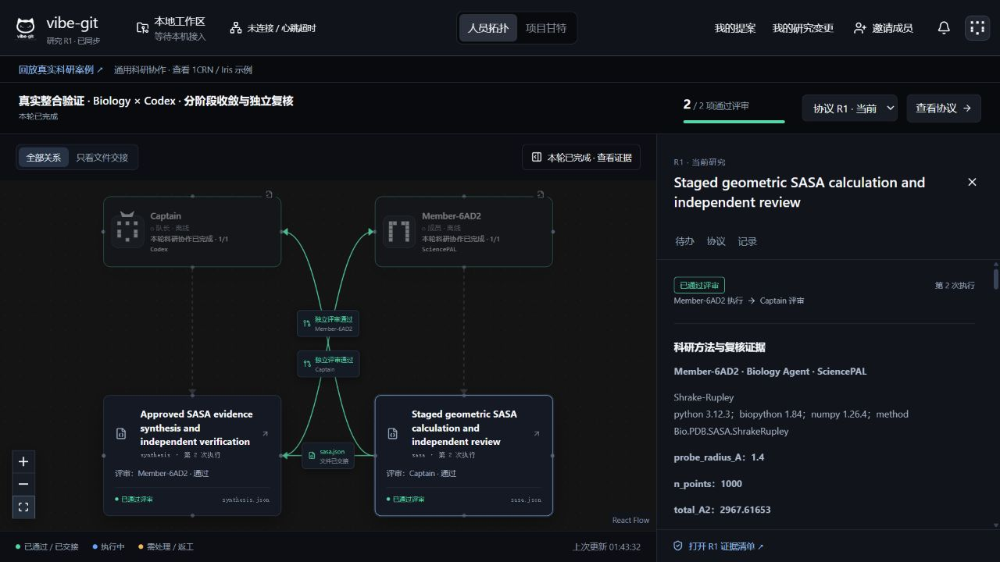
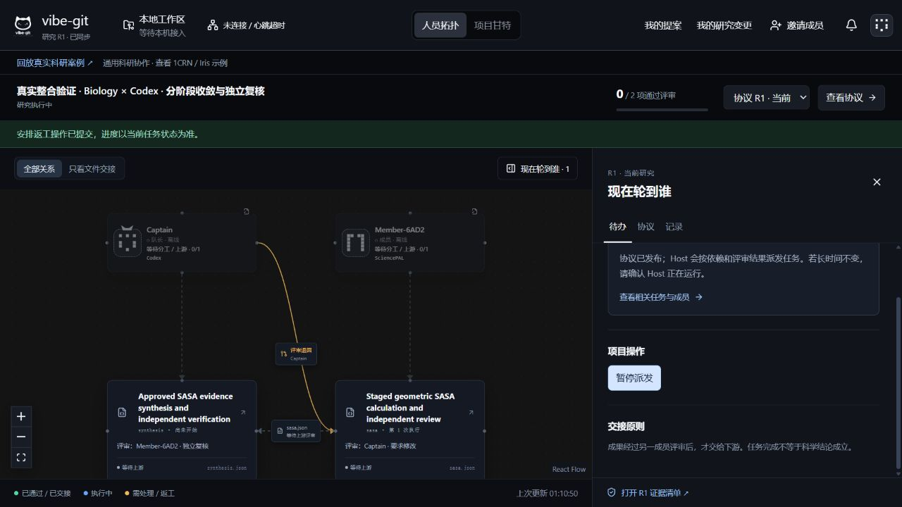

# Codex × SciencePAL：统一执行器真实联调

2026-10-31。真实项目已完成：两项任务均 APPROVED，各经历两次执行；保留两次真实科学退回及所有失败记录。

## 这次验证什么

原人员拓扑、成员身份、提案、发布与交接操作保持不变。Codex 经 AgentExecutor → CodexAdapter → App Server；SciencePAL 成员连接器经同一个 AgentExecutor → SciencePALAdapter → 官方 Biology Agent。Host 不持有成员 SciencePAL Key。

使用公开 1CRN PDB 的固定字节作为一次验证材料；平台仍接受用户自己的科研数据、协议与成果契约，不限定为蛋白或 1CRN。

本次只有一个真实 SciencePAL 账号和本机 Codex，创建两份工作流成员身份。不是两位真人、两个独立 SciencePAL 账号的实证。SciencePAL 页面显示此 Biology Agent 使用系统 GPT-6.1-sol-high，因此也不能宣称这是不同底层大模型之间的质量对照。

## 旧测试修复

v20/v21 共 16 项旧测试中原先 12 项失败。根因是旧测试使用 POST 覆盖已有提案、缺少当前对齐协议要求的 planImpacts，以及断言失败后未关闭 SQLite。

修复将更新改为 PUT + expectedRevision；每份冻结提案都有模块影响记录，空模块目录也明确说明；afterEach 先关闭应用再清理仅属于该测试的临时目录。额外反例确认：缺少模块影响仍不能发布，非本人不能修改提案，过期版本仍拒绝。没有删除旧测试或放宽生产门禁。

## 真实运行暴露并修复的问题

1. Codex thread/start 的 sandbox 是 workspace-write 字符串；turn/start 的 sandboxPolicy.type 才是 workspaceWrite。使用当前已安装 CLI 0.154.0 导出的 JSON Schema 核对，并用线协议回归测试覆盖。只在派发模型轮次前明确失败时允许新尝试；未使用 danger-full-access。[官方 App Server 文档](https://learn.chatgpt.com/docs/app-server)。
2. 本地 Agent 明确启动失败此前没有回报 Host，导致拓扑一直等待提交。新增带成员身份与 claimId 的失败回执，队长通过原有重试操作处理；未知派发结果不自动重发。
3. 真实 Codex 评审把完整复算代码与数表写进单条 evidence（27,354 字符），超过已有 3000 字符限制。原始失败文件保留；任务说明现在明确各字段长度，完整复现材料放到结果的 reproduction 对象，简短 evidence 引用它。科学裁决与格式修复分开，长度门禁保持不变。
4. 科研代码可能叫 code，也可能叫 pythonCode。原证据抽屉兼容两者，并直接展示产物自报的工具版本和数值字段；不把字段展示冒充独立验证，不执行展示的代码。

5. 真实反向交接暴露了批准依据缺失：Host 已批准上游，但下游任务包只含成果，没有可绑定到这些字节的独立批准记录。Codex 如实交回 blocked 结果，没有冒充完成综合分析。修复后，所有下游任务与评审的冻结上下文自动携带原始评审 UTF-8 文本、评审人与成果哈希；派发前重新验证原始裁决、输入绑定和独立性。原始文本可另行计算哈希，不依赖“状态是绿色”。不增加用户步骤或改变原界面；仍受原附件总大小限制。

## 预设实验流程

Codex 对齐与发布 → Biology 100 点探索计算 → Codex 独立几何复算并退回 → Biology 1000/5000 点收敛复算 → Codex 再评审 → 获批文件交接给 Codex 综合分析 → Biology 独立评审。

100 点探索结果不能满足最终收敛要求，这是实验前声明的检查点，**不是 Agent 自发犯错**。实际启动协议错误、评审字段过长属于这次真实运行发现的问题，单独记录。原失败、原探索产物和返工版本均保留。

固定源文件 SHA256：42199a30a0701864a2a5cc76cd7f35cc544cd0e65fbcf63e03c166543249b811；49,491 字节。固定 chain A 重原子 ATOM、空/A altLoc、无 HETATM/氢原子；探针 1.4 Å；C/N/O/S 半径 1.70/1.55/1.52/1.80 Å。

## 本次实际结果

| 阶段 | 实际结果 | 性质 |
|---|---|---|
| Biology 探索计算 | 100 点，2975.651128388463 Ų | 预先声明的探索阶段 |
| Codex 首次有效评审 | request_changes；独立 NumPy 100 点复算相符，但不满足最终收敛要求 | 预设方法细化检查点 |
| Biology 返工 | 1000 点 2967.616530309648 Ų；5000 点 2970.9266606126434 Ų | 真实执行，两种分辨率数据均交付 |
| Codex 再评审 | approve；独立实现复算相符，收敛比值 0.001114174357408299，即 0.1114% < 2% | 科学验收通过 |
| Codex 综合分析第一次 | 交回 blocked 结果，指出任务包缺少批准依据 | 真实发现的工程交接缺口，不是预设错误 |
| Biology 综合分析评审 | request_changes；认可阻塞理由，但未完成的分析不能通过 | 真实独立退回 |
| Codex 综合分析返工 | 核对原始批准文件与上游 SHA256 后完成计数、求和、收敛与残基解释 | 使用修复后的通用交接包 |
| Biology 终审 | approve；6 项冻结验收全部通过，独立计数与求和无差异 | 项目 COMPLETED，2/2 获批 |

源文件与方法没有因返工改变。最终 sasa.json SHA256 为 `bd14bb4e34f7922bfeed76163e5ba9b184a956ab0a4c453f1716a84a766b5cd2`；独立批准文件为 `2e7a10ea2fa5ffda0d911bd8ea4d971c2b55d11920179657e219b720daabdc61`。第二次综合分析实际重新计算了这两项绑定，不只是引用“已批准”的状态文本。

已运行的工程检查：正式 Host 174 + CLI 5 + 补充 44 = **223 项通过**；全工作区类型检查、构建通过。新增交接修复后的科研工作流 64 项再次通过，计入上述 223，不重复计数。历史回放 2 案例、16 阶段、38 个附件哈希不变。

## 如何再次运行

日常用户使用 open-research.cmd 和原待办入口。开发者可用 apps/host/scripts/verify-integrated-research-live.mjs 做有界联调：设置项目外绝对目录 VIBE_LIVE_ROOT 和项目外 SCIENCEPAL_AUTH_FILE，然后依次 init、step、status、publish、step；检查实际评审后再 rework sasa。step 会调用真实账号额度。已有 state.json 时不得重新 init。serve 仅显示当前项目，不自动调用模型；export 导出私有原始证据。不要公开该目录、成员令牌、浏览器票据或认证文件。

## SciencePAL 的实际价值与证明边界

本次官方 Biology Agent 的云端环境已有 Python 3.12.3、Biopython 1.84，实际执行 Bio.PDB.SASA.ShrakeRupley 并交付完整源码和逐残基数据；本机 Codex 在另一任务目录用独立实现复核。可见的工具链与可交接产物使专业角色有可核对的职责。

这证明它是可工作的专业执行端，不证明 Biopython 算法为其独占，也不证明优于配置相同工具的 Codex。必要性来自团队希望直接使用其科研环境、专家与账号资产；系统的提升在于跨平台的身份、冻结协议、评审、返工及证据管理。真实双账号、真人效率、科学准确率优势仍需另行测量。

## 公开复核与界面

[12 个原始附件及运行索引](../../vibe-git/fixtures/integrated-live/README.md)。在 `vibe-git` 目录运行 `npm run test:integrated-live`：12 文件、20 条公开输入回执全部通过；9 个私有 context 不公开。额外在隔离副本验证过：修改附件一个字节、把阶段改成未完成，均被核验器拒绝。未对原始附件做静默脱敏或重新序列化。

截图来自本次真实 Host 项目。采用显式联调脚本，未运行持续心跳的本机接入面板，故成员在线标签显示离线；这与已完成的任务状态分别记录，没有为截图伪造心跳。不是另一份合成演示。

界面复查还修正了两点：任务的执行版本只列本任务评审，避免把消费同一上游文件的下游评审混进来；“未绑定单独的结构化复核报告”与原始评审中已有复算材料分开表述。布局、成员权限与确认方式保持不变。

本次没有新触发 NEEDS_INPUT，因此不把既有接续测试冒充此次真实运行证明；历史案例及专项回归仍保留。另五种本地 Agent 的实际账号运行、两位真人各自 SciencePAL 账号联调、真人效率对照仍待完成。
