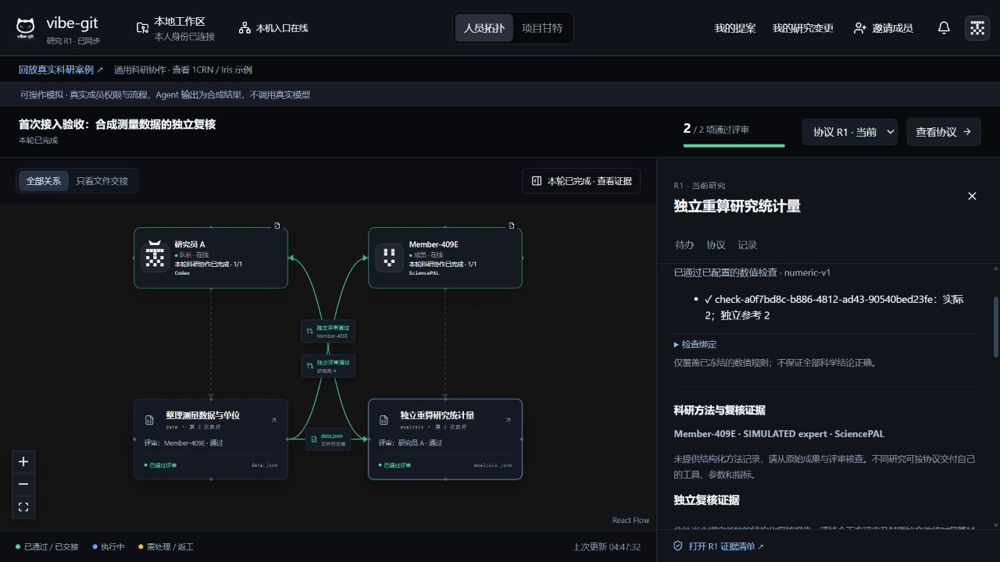

# 评委与首次接入体验复查 · 2026-10-31

本轮以已有真实科研证据为基础，检查演示表达和实际产品操作。浏览器中的新流程为隔离合成演练；没有调用真实 SciencePAL / Codex 模型，不是两位真人、两台电脑或真实账号的新验收。

## 评委视角：结论与已修正问题

作品的核心应是“多人各用自己的 Agent，仍能按共同科研协议交付可复核的成果”。原成员拓扑、提案和队长对齐是已有基础；新增贡献是跨平台执行、冻结研究输入与约束、数值门禁，以及批准依据随成果交接。不能把原有多人协作功能重新算成创新。

| 发现的问题 | 本轮修正 | 怎么核查 |
|---|---|---|
| 视频说明了流程，但没有及时讲清与原版的能力差别 | 重写第 5 场英文配音与中文字幕，明确保留项和新增项；播放页增加直接说明 | 视频约 00:55 起 |
| SciencePAL 只被描述成运行 Python，容易被理解为装饰性接入 | 第 10 场用三层分工解释官方 Biology Agent 云端执行、Codex 独立复核、平台协议与交接；保留可复现算法的边界 | 视频约 02:12 起，公开核查记录与原计算记录分别标注 |
| 接入材料同时要求源码 ZIP、旧专用包校验和多个高级命令 | 用当前仓库 ZIP 为主路径，注明进入内层 vibe-git；专用包校验改为条件说明 | SCIENCEPAL-QUICKSTART.md、原接入说明弹层 |
| localhost 邀请容易被当成跨电脑地址发出 | 保留原邀请入口，把复制按钮标为“复制本机演练邀请” | 隔离队长界面实际验证 |
| 发布确认没有提醒数值检查是否已配置 | 在原确认框直接说明已冻结 / 未配置及发布后的限制；交接原则同步更新 | 原协议、待办和发布确认；不增加新页面或绕过权限 |
| 专用接入包遗漏新队长启动器和快速说明 | 补全打包白名单；源码 ZIP 与专用包都可使用同一入口 | 新包 340 文件（含清单），逐项哈希通过，新解压目录首次安装和全工作区构建通过 |
| 上传文案说“发布前不会执行模型”，但对齐也需要模型 | 改为只承诺上传和建项不调用模型，单独说明对齐与执行使用账号 | 原上传组件文案及构建检查 |
| 等待输入说明有“直接在本页填写”的歧义 | 统一说明为从待办前往 SciencePAL 原线程回答，保持连接器运行自动接回；CLI 作为备用 | 当前界面动作、完整接入说明与快速说明一致 |

SciencePAL 在当前验证中承担了可追溯的科研执行，有实际用途；这不证明其算法独占、相对 Codex 更准确或相比手工显著节省时间。要提升竞赛说服力，下一项高价值证据是两位真实队友独立接入和一次相同任务的手工交接对照，不是继续堆平台数量。

## 首次接入：实际浏览器验收

使用仓库自带 `npm run research:simulate-ui`，两个独立本机身份，从未接入状态开始。所有 Agent 输出为合成数据，原 Host、权限、待办和连接器状态真实运行。

1. 队友输入邀请，打开快速说明，再返回：邀请保留，不用重填。
2. 队长绑定 Codex，自动进入本人提案；队友验证模拟空专家目录，看到明确提示，换可用模拟凭据后选择专家并绑定 SciencePAL。
3. 双方分别保存自己的提案。队长上传自建 measurements.csv（[1,2,3]，单位 a.u.）、填写来源和用途，选两人冻结建项。
4. 队长启动对齐，发布前在原协议抽屉为 analysis 任务冻结 value=2 的独立手算参考，绝对容差 0.001，参考绑定上传源文件。
5. 队长发布；队友从本人待办启动连接器，领取独立评审。首轮 data.json 缺少单位，被退回，下游显示“交接已阻断”。
6. 队长直接使用自动带入的修改项安排返工；第二次执行通过独立评审，data.json 连同批准依据交给下游。
7. 最终 2/2 任务通过。analysis 任务显示“实际 2；独立参考 2”；交接抽屉显示上游生成、独立批准、下游收到均通过。旧执行与评审保留。

浏览器这一轮没有触发 NEEDS_INPUT，不将其写成浏览器实测通过。另运行现有 `sciencepal:simulate -- --mixed`：20 个检查点通过、13 次运行、1 次原线程接续、2 个需求版本，最终 COMPLETED；该检查使用真实本地领取/提交 CLI 与模拟远端，不代表真实模型或真人双账号。

## 本轮检查

- 新解压专用接入包的真实首次准备通过：安装 348 个包，安装时报告 0 漏洞，随后全工作区构建通过；未启动模型。
- 全工作区构建通过；前端最后修改再构建通过。仍有既存大分块提示。
- 科研专项 212 项通过；首次准备 / 更新指南触发重建 / 队长入口共 3 项通过。
- 混合平台离线验收 20 个检查点通过，覆盖成员权限、缺单位退回、返工、双向评审、接续与需求变更。
- 旧回放 2 案例 / 16 阶段 / 38 附件、整合案例 12 个原始文件 / 20 条公开回执核验通过。
- 新视频 289.42 秒，英文合成配音、中文字幕；全解码与关键画面检查通过。公网播放验证记录见提交目录 artifact-checks.json。

## 仍然需要真人验证

跨电脑 HTTPS 房间的准备仍由队长完成，不是完全免配置；没有自动开放公网。成员本地 Codex 需要安装并登录，SciencePAL 需要本人可用的 API 权限。尚未完成真实第二账号、第二台电脑和首次接入耗时测试；因此没有给出效率提升百分比或用户满意度分数。
