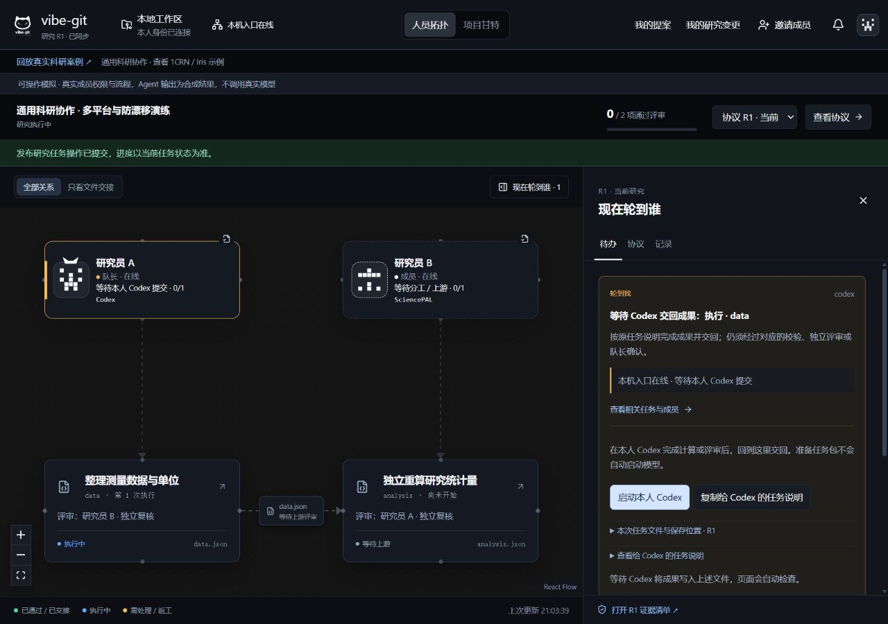
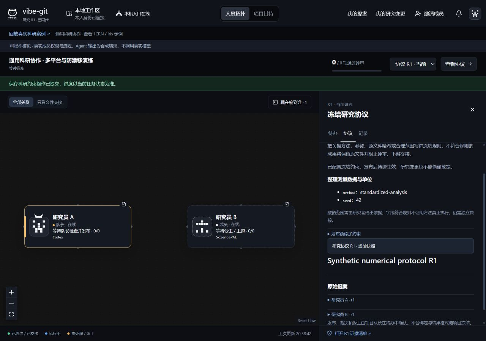

# 队友适配器 × 通用科研协作

本次把队友的执行接口作为共同入口，保留原人员拓扑、提案、队长发布、待办与交接逻辑。SciencePAL 通过第七个适配器接入；其他 Agent 不再被伪装成 Codex 身份。

## 怎么使用

1. 每位队友打开本机入口，在原“算力网”选择自己的平台。SciencePAL 读取本人账号的专家目录；本地 Agent 先在本人电脑安装、登录。
2. 仍按原步骤保存提案、上传源文件、建立项目并对齐。项目冻结成员、平台和任务负责人，之后修改算力网绑定不会偷偷改变已有项目。
3. 队长在右侧 **协议 → 科研防漂移 → 发布前添加约束** 选择任务和成果字段。可固定方法/单位、参数/随机种子、允许数值范围，或自动固定上传源文件的 SHA-256。无需手写 JSON。约束是任务 result 的顶层字段；嵌套结构可在建项时提供既有 JSON Schema。
4. 队长从待办发布。SciencePAL 成员启动本人连接器；本地成员在待办点击 **准备本人任务包 → 启动本人 Agent → 检查并交回成果**。也可复制说明到自己的 Agent 处理同一目录。
5. 文件字节、输入回执、版本、类型、固定值和范围通过后，才派发独立评审。退回后队长安排返工；通过后自动交接下游。NEEDS_INPUT 继续沿用 SciencePAL 原线程与连接器日志接续。

截图来自隔离合成演练，不代表本次又调用了真实科研模型。原有 1CRN、Iris 真实回放保持独立标注。

## 如何组合两部分代码

| 位置 | 本次整合 |
|---|---|
| agent-types / registry / executor | 使用队友提供的共同接口、注册与执行结构；默认 VIBE_AGENT=codex |
| 六个本地 adapters | 保留平台职责；共用进程生命周期，修正 CLI 参数、ESM 探测、环境透传、错误事件和中断处理 |
| adapters/sciencepal.ts | 通过原 SciencePAL 客户端发送冻结文件，返回 cloud 运行身份；领取、持久日志、回收、NEEDS_INPUT 接续仍由原连接器管理 |
| 本人任务入口 | 使用项目冻结的平台选择适配器，忽略环境变量中另一个平台；重复点击、丢失回执、重启不会重新启动同一个任务 |
| 科研门禁 | 重用不可变成果契约；在首次发布前收紧，发布后不可替换。变更不能放宽已有约束，需另立项目重新定义 |
| 原 UI | 仅扩展算力网选项、待办按钮、协议抽屉和成果检查展示，未重写布局或样式 |

统一的是身份、任务、文件、门禁和评审，不是所有平台的科研工具。SciencePAL 的作用是使用本人账号实际可用的科研专家与工具；专业优势仍须由具体研究的工具记录和独立复核支持，不能凭平台名称声称不可替代。

## 已验证与尚未验证

- 科研与适配器回归：**186 项通过**。六种本地身份分别与模拟 SciencePAL 跑过执行、双向评审、退回返工、第二版需求、旧成果拒收和证据导出。
- 真实 Node 子进程验证：环境与参数传递、stdin 结束、零退出码的错误事件识别、启动失败、中断。SciencePAL 使用注入的测试后端验证原文件传递与 NEEDS_INPUT，不消耗账号额度。
- 本地执行器验证：冻结平台优先、重复启动阻断、完成状态保存、重启不重发。权限测试覆盖非队长修改约束被拒、错误平台绑定被拒。
- 界面人工操作：保存两条约束、原流程发布、领取任务包、交回 seed=41 的受控错误样本（协议 seed=42），观察校验失败与下游交接阻断。
- build、全工作区 typecheck 通过；CLI 5 项、relay 10 项通过。真实回放 2 案例、16 阶段、38 文件字节校验通过。
- **全仓库 npm test 并非全绿**：原 v20/v21 软件流程 16 项中 12 项失败。在修改前公开 HEAD `fe7f993` 的隔离源码快照复现相同的 12 项主断言失败；Windows 还出现失败后数据库未关闭的 EBUSY 清理错误。此次未放宽生产校验或删除这些旧测试。需要另行修复旧测试/旧软件流程契约。
- 本机只读探测 Codex CLI 0.154.0 已安装、登录且可用。没有声称本次真正执行了六种模型。真人双账号、各平台真实账号额度与授权仍待队友联调。

| 平台 | 当前边界 |
|---|---|
| Codex | 默认兼容原执行器；Windows 自动寻找标准 npm 安装内的原生 exe，或使用 CODEX_BIN |
| SciencePAL | 从科研成员连接器使用 cloud 适配器；旧软件 Relay 没有科研文件接口，不能用它代替科研连接器；不伪称支持远端取消 |
| Claude / Gemini / OpenCode | 无交互 CLI 适配已接入；仍需本人安装和登录，真实模型执行待验证 |
| Cursor | 默认无交互模式不可写文件，界面明确转向复制任务说明；不会自动添加强制授权开关 |
| DeepSeek / DSH | 保留队友 dsh --profile headless 调用约定；尚未完成真实 DSH CLI 参数和账号验证 |

Windows 非原生脚本 shim 不会通过 shell 拼接执行用户提示。除 Codex 标准安装自动发现外，可将对应 `CLAUDE_BIN`、`CURSOR_BIN`、`GEMINI_BIN`、`OPENCODE_BIN`、`DEEPSEEK_BIN` 配为真实可执行文件；探测失败时使用任务说明入口。运行中退出本机入口可能留下未知状态，必须核对原进程和目录，不能靠换目录重跑。记录保留在本人项目外工作区。

约束只能检查产物中可核对的字段，不能证明 Agent 真正采用了声称的方法，也不能保证科学结论为真。原字节回执、独立重算与审稿证据仍必要。未配置约束时，UI 会明确显示，而不是自动宣称已通过防漂移。

## 来源与复用决定

队友提供的 `多Agent改造代码.zip` SHA-256：`80f33420d915d2c48b1317ad4fd5532b61619c649163ccea53cc28f05725f408`。此次按实际代码结构整合并修正，没有把另写的接口冒称为原封不动合入。原 Vibe-Git 作者为队员，沿用原历史与归属；未额外授予第三方代码许可证。

按项目要求完成过定向 GitHub 搜索：`vibe-git user:TFboy1` 找到原项目与关联 skill，复用当前队员项目，不新增外部依赖。原项目未声明许可证，不能把它表述为任意第三方都可再许可；本队共享基于作者参与和授权。检查时原项目未归档，最近推送为 2026-10-14。`deepseek harness dsh` 返回的 strongest results 为 awesome-dsh-plugin/awesome-dsh-plugin、beancookie/awesome-dsh-plugin、zhu1090093659/dsh-web；与所需官方执行接口不匹配，未进入代码复用候选，不复制其代码，因此未据其许可证或活跃度作采用判断。

CLI 参数修正参考官方文档：[Claude Headless](https://code.claude.com/docs/en/headless)、[Gemini Headless](https://geminicli.com/docs/cli/headless/)、[OpenCode CLI](https://opencode.ai/docs/cli/)、[Cursor Headless](https://cursor.com/docs/cli/headless)。未安装新的运行依赖。
