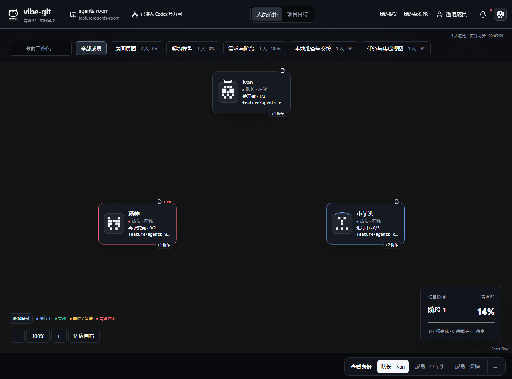
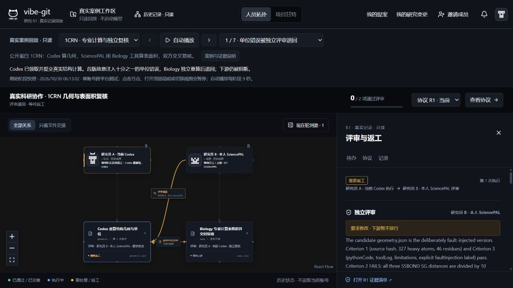
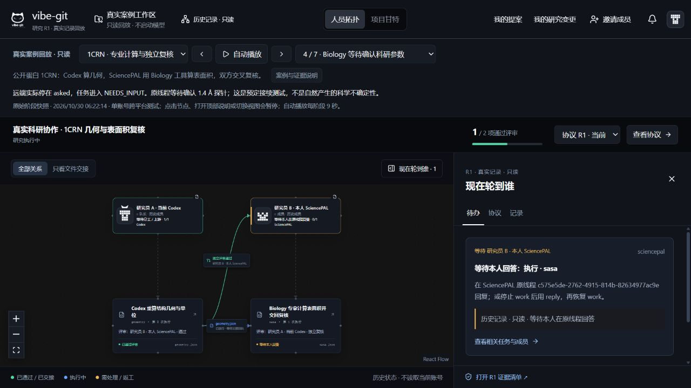

# 完整展示：研究协议如何变成可追溯的合作

这是通用科研协作平台。先展示共同工作机制，再用两个不同案例说明机制，不把 1CRN 当作产品本身。

## 30 秒定位

不同成员可以保留自己的 Agent 与账号。提案对齐为研究协议，任务有负责人、依赖和评审者；获批成果用原始文件交接，下游核对实际收到的字节。原拓扑显示现在轮到谁，保留返工和等待输入的历史。

## 看得见的变化

| 原版保留演示 | 当前实际构建界面 |
|---|---|
|  |  |

旧图来自 `ui-review/agents-product-plan-mock.html` 的演示数据；新图来自真实科研案例的历史回放。两图展示交互结构的继承，不能用于声称相同任务下的效率差异。

沿用顶部、人员拓扑 / 项目甘特、右侧详情；新增成员平台、研究任务、文件边和独立评审边。工具、参数和复核证据放在任务详情中，不另造一个脱离原版的产品界面。

## 3 分钟现场演示

1. **通用入口，30 秒**：说明新项目写自己的提案、上传自己的材料、选择本人 Agent。案例只是可选快捷模板。真人协作需各自账号；回放无需账号。
2. **专业证据，40 秒**：1CRN 完成阶段点击 Biology 任务，展示实际 BioPython 版本、1.4 Å 探针、960 采样点、结果与独立 NumPy 复算。展开代码与来源边界。
3. **退回和返工，40 秒**：选择阶段 1，说明单位错误是受控注入。文件未放行；查看评审和后续格式失败，修正后才能继续。
4. **原线程接续，25 秒**：选择等待输入与下一阶段，展示同一线程、不同 run 和真实续接回执。参数确认是预先安排的测试。
5. **实际交接，25 秒**：选择交接阶段，点文件边核对三项回执，区分“批准放行”和“下游实际收到”。
6. **不同案例，20 秒**：切换 Iris，查看九阶段、两次退回，说明第二次缺代码是实际产物问题；没有出现等待输入，不伪造该阶段。

## 专业结果能支持什么

1CRN：SciencePAL 2970.152447 Ų，独立参考 2973.162771 Ų，差异约 0.10125%，在冻结容差内。参考采用相同算法家族的独立 NumPy 实现和不同采样点；不等于独立理论或实验真值，也不构成新的生物学发现。

它支持“实际专家环境执行、交付可复核产物、跨平台复核与交接”的结论。它不能证明 SciencePAL 在所有科研任务优于 Codex，或无法用其他环境替代。

## 队友可以查什么

- [案例说明](../../vibe-git/SCIENCEPAL-CASE-BRIEF.md)：研究问题与结论边界。
- [1CRN 原始产物目录](../../vibe-git/apps/web/public/research-replay/1crn/) 与 [Iris 目录](../../vibe-git/apps/web/public/research-replay/iris/)：case、manifest、评审和附件。
- [交接对照原始结果](evidence/handoff-comparison.json)：包含系统未能拦截的盲点。
- [演示启动说明](START.md)：无需账号回放，以及明确标记的可操作合成演练。
