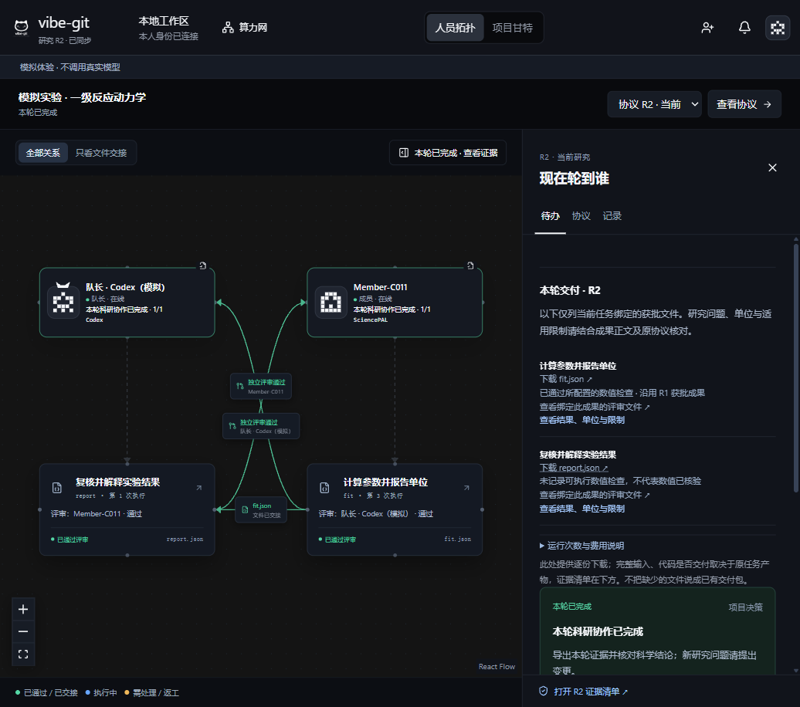

# 普通使用流程与错误恢复验收 · 2026-10-31

本轮在 ego lite 中按原界面操作完成两位成员的接入、建项、对齐、发布、计算、评审退回、返工、交接、报告变更与第二轮交付。**使用生成数据和确定性模拟执行器，没有调用真实 Codex / SciencePAL 模型，也不是独立新用户实验或真人跨账号验证。** 另在既有真实 1CRN 只读回放上测试了复核记录读取恢复，不修改历史证据。

前一次测试环境关闭后，用户确认重新开启隔离演练。本轮不是连续实时录屏；小窗口操作需要滚动，浏览器自动化曾遇到遮挡和窗口最小化，恢复后继续。没有将自动化定位失败计为产品错误，也不据此声称普通用户已经能完全独立使用。

## 做了哪些操作

案例：六个无噪声浓度时间点，以自然对数、带截距最小二乘估计一级反应速率，再由获批参数计算半衰期。成员分别模拟 SciencePAL 计算与 Codex 复核/报告，互相评审。固定方法 natural-log-ols，速率独立参考 ln(C0/C10)/10 = 0.10000000000000062 min^-1，绝对容差 1e-8。

| 人遇到的情况 | 原界面操作与实际结果 |
| --- | --- |
| 邀请链接写错 | 显示完整邀请格式要求，保留输入；改正后成功加入，没有重复注册 |
| 替换为非 UTF-8 文件 | 保留 140 字节原文件、来源与署名；建项被阻止 |
| 关闭后重新打开建项弹层 | 原名称、成员选择、文件与替换失败提示仍在；明确选择“继续使用原文件”后建项 |
| 对齐遗漏需求 | 缺失原文被列出，不能发布；只重试对齐后覆盖 4/4 条 |
| 错误速率 0.12 | 与独立参考 0.10 比较失败，阻止评审和下游交接，原文件保留 |
| 评审添加原协议外要求 | 拒绝将其作为退回依据，提示另提研究变更；只重试评审 |
| 合法退回：缺原单位 | 队长安排返工后，成果保留，修正版本重新评审并获批 |
| 成果读取断开 | 在当前标签页临时阻断该文件请求；中文提示保留原成果，点击重读恢复。作业数 10→10，项目 JSON 不变 |
| 第一轮交付 | 从“本轮交付”实际点击下载 report.json，下载字节 SHA-256 与当前获批文件一致 |
| 仅改报告 | 原“提出研究变更”→独立影响评审→队长应用→重新对齐发布→报告与评审，R2 完成 |
| 第二轮下载 | 下载 R2 报告，核验字节，包含“尚未包含真实测量噪声”；R1 拟合成果、执行和批准标识保持一致 |
| 独立复核记录请求失败 | 在既有 1CRN 只读回放中只阻断复核文件；原结果仍显示，提示不能确认复核。恢复请求后按“重新读取复核记录”，重新核验后显示原通过结果 |

## 可核对的结果

- R1 总作业 10 次，R2 完成后总计 14 次。新增为变更评审、对齐、报告和报告评审；不能将“上游不重算”推断为整个流程已更省钱。
- 拟合计算累计 **3→3**；R2 沿用 R1 的 artifactId、executionId、reviewId，界面显示“沿用 R1 获批成果”。
- 只重试无效评审时拟合计算 **2→2**。这与补证复审是不同操作；本模拟因同一成果已有两次评审，未再次走补证入口。
- 半衰期 **6.931471805599421 min**。R2 报告数值不变，仅增加噪声局限说明；生成数据不证明真实反应机理。
- 补证不重算的真实证据仍引用[最新治理版真实闭环](LATEST-GOVERNANCE-LIVE-20261031.md)，不把本轮评审重试混称补证实跑。

[状态核对摘要](usability-recovery-20261031/reuse-check.json) · [读取恢复摘要](usability-recovery-20261031/file-reread-check.json) · [复核读取恢复摘要](usability-recovery-20261031/proof-reread-check.json) · [实际下载的 R2 模拟报告](usability-recovery-20261031/report-r2.json)

这些是走查观察与摘要，不是完整可独立重演的远端计算证据包。原始模拟会话、邀请、身份凭据和本机工作目录不发布。

## 本轮修复

1. 复核记录增加独立重试。未绑定、正在读取、文件不存在、连接失败分别显示；失败时保留成果，不把未知状态显示为通过。重试重新校验成果和绑定记录的字节数、哈希及身份，不调用模型。
2. 网络失败改为中文提示，说明检查连接后重读。文件被替换或哈希不一致仍拒绝。
3. 返工确认根据当前实际待办决定是否建议补证；同一成果已有两次评审（含无效评审）时，不再建议用户寻找不可用按钮。后端限制保持原样。
4. 建项与未保存提案明确仅在当前页面保留，刷新/关浏览器会丢失；没有新增持久化草稿系统。

## 验证与停止范围

科研专项 **304 项**、原版兼容 **37 项**、类型检查与完整构建通过；两套测试含重叠项，不相加作为唯一测试数。既有真实案例 **31 附件、34 输入回执**及历史回放核验通过；这是离线核验，不是重跑真实模型。复核恢复回归还验证篡改候选文件时拒绝，读取请求仅 GET。

原 CSS 文件及拓扑/Gantt骨架、顶部入口、队长权限、发布/评审/变更顺序不变。本轮只改既有确认与详情区域；没有添加平台、安装系统、自动批准或新的操作入口体系。

**尚未完成：** 独立研究者的无协助首次使用实验、真人操作时间对照、跨刷新草稿恢复、自动结论摘要/完整交付包。现有视频与 PDF 未重新制作，不将此次走查写成已录入视频。实名信息与正式参赛提交回执仍须按原提交清单处理。
