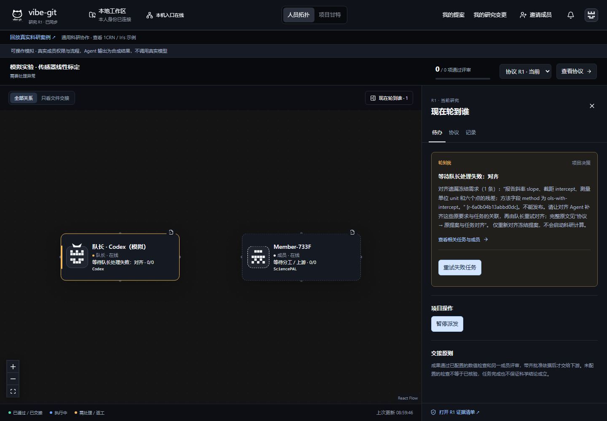
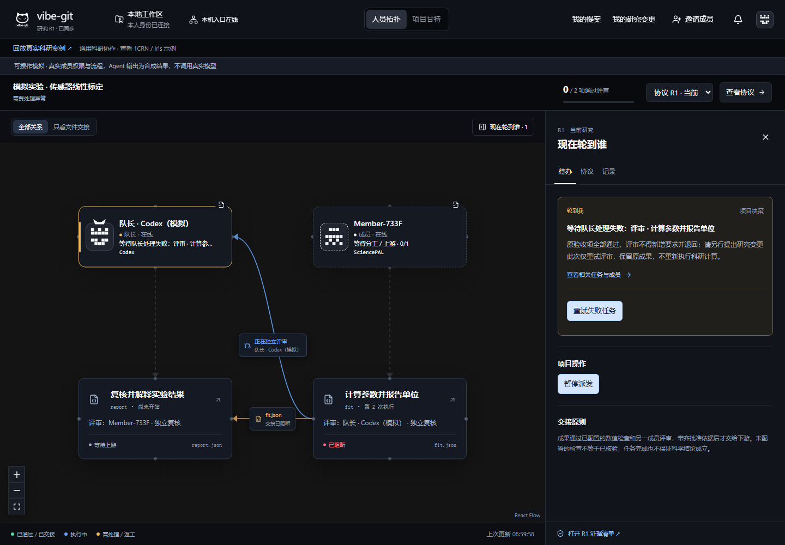
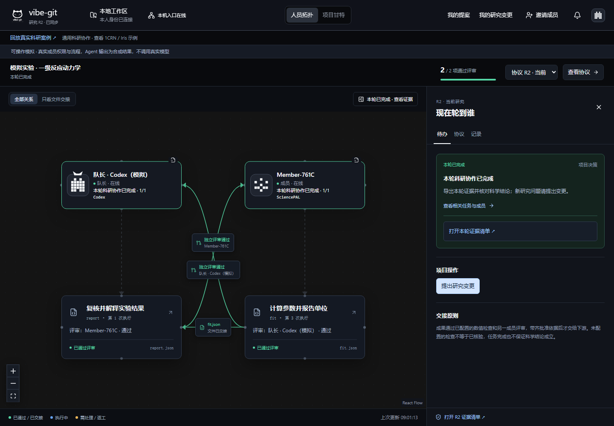

# 两套新实验：完整流程与使用者验收

2026-10-31。实现起点 `6f4c560`，本轮不增加平台、不改变原版拓扑、布局、CSS 或成员权限。

**结论：传感器标定和一级反应动力学均完成了界面建项、对齐、执行、独立评审、返工、交接及第二轮变更。** 每套 12 项浏览器检查通过。模拟输入由本项目生成；数值计算实际运行，Agent 回复由可控程序生成，没有调用真实 SciencePAL / Codex 账号。

这次证明的是：换数据和任务后，流程与防偏移规则仍能工作，以及页面给出的下一步能否操作。它不证明真实模型会正确理解任何科研问题，也不是首次使用者独立完成的用户研究。

## 两个实验做了什么

| 实验 | 输入与方法 | 实际结果 | 受控错误 |
|---|---|---|---|
| 传感器线性标定 | 六个位移/电压点；带截距最小二乘 | 斜率 2.037142857 mV/mm；截距 0.157142857 mV；5.25 mV 对应约 2.5 mm | 第一次实际改用过原点拟合，方法门禁阻断 |
| 一级反应动力学 | `C(t)=100 exp(-0.1t)` 生成六个点，保留 12 位小数；自然对数后线性拟合 | k≈0.1 min⁻¹；半衰期≈6.931471806 min | 保留正确方法标签却将 k 放大 20%，数值门禁阻断 |

执行计算使用中心化最小二乘；标定参考使用原始求和公式，动力学参考使用端点浓度比。模拟数据的构造本身已知，不能把这种独立公式核对包装成未知真实实验的科学发现。

两个案例都额外注入：对齐漏掉一条原要求、评审擅自追加无关实验、合格数值遗漏单位。最后增加一条报告局限说明，核验计算任务及原批准能复用。

## 按人的操作走了哪些步骤

所有建项、发布、重试、返工及变更决定都通过原页面按钮提交，没有用后台 API 替用户作这些决定。只有模拟 Agent 和测试结果断言运行在后台。

1. 成员粘贴邀请，在算力网绑定模拟 SciencePAL，保存本人的提案；队长绑定 Codex 并保存自己的提案。
2. 队长从原建项弹层选择成员，上传 CSV，填写来源和署名，再冻结提案。
3. 启动对齐。第一次漏项被拦截，页面提示缺失原文；队长重试对齐。
4. 在原协议抽屉配置固定方法和独立参考值，再发布任务。
5. 成员启动连接器；错误方法或数值被拦截，文件保留，下游不放行。
6. 修正执行后，第一份评审越权新增要求，被拒收；只重试评审，作者不重新计算。
7. 合法评审发现产物遗漏单位，队长安排返工；新的成果经独立复核后交给报告任务。
8. 报告读取获批文件的真实字节，完成结果换算与限制说明，再由另一成员评审。
9. 第二轮只增加报告对真实测量噪声的限制。队长核对影响列表后应用变更；原拟合文件、批准和来源版本不变，报告重新执行与评审。

每套记录了 91 次点击/填写调用，包含故障注入后的恢复、重复打开待办、检查及两轮协议；上传、选择器和自动等待未全部计入。这个数字**不是普通用户的最短步骤数，更不是节省时间的证据**。全量调用记录见[验收摘要](evidence/workflow-experiments/summary.json)。

## 实际发现与修复

| 用户遇到的问题 | 原因 | 这次修复 |
|---|---|---|
| “遗漏 r-xxx”看不懂，不知道找谁改 | 错误只包含内部编号 | 同时显示原要求摘录、遗漏数量及“补齐关联后重试对齐”的操作说明；完整原文留在协议抽屉 |
| 失败待办的“查看相关任务与成员”跳到队长而非失败任务 | 重试动作只在提交参数中携带运行 ID，展示层拿不到 | 待办携带实际失败运行 ID，详情进入对应任务 |
| 不清楚“重试失败任务”是否会重算科研结果 | 各类运行共用泛化提示 | 待办和确认框区分对齐、计算和评审；评审明确保留原成果，计算提示已用执行次数 |

前两处由回归测试先复现失败，再验证修复。原方法、数值门禁和权限没有放宽。三次执行上限保持不变：早期把多个错误都堆进同一任务会用尽上限；正式验收将方法错误和数值错误分到两套实验，而不是提高上限凑成功。







## 你一个人怎么体验

在已经安装依赖、构建完成的 `vibe-git` 目录，只需启动一次演练：

```powershell
npm run research:experiment -- calibration
```

另一套把末尾换为 `kinetics`。终端会给出队长、成员和邀请链接；打开两个本机页面，模拟两位成员。保留终端，结束时按 Ctrl+C。演练使用临时独立房间，不写入现有项目，不需要真实 Key。

- 成员在 SciencePAL Key 栏仅填 `SIMULATED-ONLY`，不要填真实密钥。
- 启动终端会指向 `START-HERE.md`，里面有页面链接和步骤；同目录有两份可直接复制的提案及 CSV，无需阅读代码。公开提案：[标定队长](evidence/workflow-experiments/calibration/captain-proposal.md)、[标定成员](evidence/workflow-experiments/calibration/scientist-proposal.md)、[动力学队长](evidence/workflow-experiments/kinetics/captain-proposal.md)、[动力学成员](evidence/workflow-experiments/kinetics/scientist-proposal.md)。
- Codex 待办点“准备本人任务包”后，模拟程序会自动写出结果；等待“检查并交回成果”可点即可。此演练无需点击“启动本人 Codex”。真实项目仍须本人模型处理。
- 模拟的前几次失败是预设检查，不是安装失败。按上面的 9 步处理，不能跳过门禁。

在“协议 → 科研防漂移 → 发布前添加约束”中填：任务 `fit`、字段 `method`、固定文本值如下。再在“可执行科学检查”选择独立参考比较：

| 项目 | 标定 | 动力学 |
|---|---|---|
| 固定方法 | `ols-with-intercept` | `natural-log-ols` |
| 数值字段 | `slope` | `rate` |
| 独立参考 | `2.0371428571428574` | `0.10000000000000062` |
| 绝对容差 | `0.00000001` | `0.00000001` |
| 参考依据 | 六点原始求和最小二乘公式 | `ln(C0/C10)/10` |

填写来源网址时可使用本仓库页面；署名明确写“本项目自建模拟数据，不是实际测量”。第二轮变更可填写：“报告补充真实测量噪声尚未考虑这一局限；原拟合数据与方法保持不变。”

## 验证与浏览器范围

- 两套完整自动化流程：各 12 项、合计 24 项通过；原页面建项、约束配置和全部决定经 Chromium / Playwright 实际点击，两个隔离浏览器身份；每套 R1、R2 均完成。
- 用户指定 ego lite 后，补跑了标定实验的完整 R1、R2：成员接入、上传建项、遗漏需求阻断、方法漂移阻断、评审越权阻断、合法返工、独立复审、文件交接及报告变更后的拟合成果复用均完成。[ego R1 证据](evidence/workflow-experiments/ego-calibration/evidence-r1.json) · [ego R2 证据](evidence/workflow-experiments/ego-calibration/evidence.json)。先前临时服务已结束，因此从建项重新演练；不是恢复原内存状态。ego 的长表单自动滚动失败时，用页面滚动定位后继续正常点击/填写，没有用接口替代业务决定。截图接口超时，未提供或宣称 ego 成功截图。
- 原功能兼容 37 项、科研专项 254 项通过；全工作区类型检查、构建通过。集合有重叠，不合计为独立总数。CSS 产物哈希仍为 `index-S5r_fJW_.css`。
- 原有真实案例证据没有改写。本文件和所有新增截图均明确属于模拟。

无需浏览器、账号即可核对公开证据：

```powershell
npm run test:workflow-evidence
```

开发者要重跑自动浏览器验收，可使用已经安装的 `playwright-core` 与匹配 Chromium；未将测试浏览器加入产品运行依赖。模块不在当前项目的解析路径时，把 `PLAYWRIGHT_MODULE` 设为其 `index.mjs` 的绝对路径，然后运行 `npm run test:workflow-experiments`。默认结果在忽略提交的 `data/workflow-experiments` 下。不要把临时会话文件或成员凭据发到仓库。

## 从使用者角度仍需注意

这次真正减少的是找遗漏原文、判断谁该重试、判断是否要重算的猜测。方法字段、参考来源和容差仍需研究者准备；不是写一句自然语言就自动保证正确。上面的填写清单帮助复现这两个案例，不等于通用自动配置。后续最值得测的是让用户在不看实现代码的情况下完成一次新数据配置，记录卡住的位置；不必继续增加平台和页面。

本次 ego 实操还暴露了小窗口下的滚动负担：来源字段、协议配置及确认按钮分布在长面板中。原版布局与样式未改；演练说明已给出可直接复制的提案和字段表，减少来回找值。浏览器自动滚动接口失败与产品易用性问题分别记录，不能以自动化最终通过代替首次用户测试。
