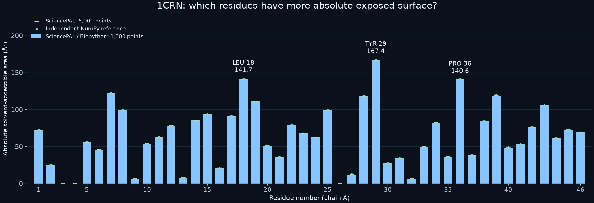

# 1CRN：哪些残基有较大的绝对溶剂可及面积？

以下使用已有真实 SciencePAL Biology 计算结果，不是新远端运行。固定 1CRN 单结构、chain A 重原子与 1.4 Å 探针；这是一项几何复核，不是生物功能或药效发现。

| 残基 | 1000 点面积 / Ų | 5000 点面积 / Ų |
|---|---:|---:|
| TYR 29 | 167.379 | 166.719 |
| LEU 18 | 141.674 | 141.046 |
| PRO 36 | 140.639 | 140.965 |
| ILE 7 | 122.080 | 121.854 |
| THR 28 | 118.663 | 118.184 |

这些残基在该固定结构中的绝对可及面积较大。不同残基大小不同，因此这不是按最大可能面积归一化的相对暴露率，不能据此断言最活跃或最重要的功能位点。CYS 3 和 CYS 4 在两档采样中报告面积为零；这是此结构及采样下的几何结果，不代表所有动态构象中都完全不可接近。

1000 点总量为 2967.6165 Ų，5000 点为 2970.9267 Ų，两者相差约 0.1114%。独立 NumPy 5000 点、不同相位参考为 2973.1628 Ų。总量一致不能代替逐残基复核；本次新增门禁同时检查求和、唯一残基和逐项参考差异。

参考比较使用预先定义的数值容差；不是置信区间，不证明误差绝对为零。独立参考在本次重新运行验证，其总量与保存的参考一致。

原始 SciencePAL 文件 SHA256：`bd14bb4e34f7922bfeed76163e5ba9b184a956ab0a4c453f1716a84a766b5cd2`。

[原始计算附件](../../vibe-git/fixtures/integrated-live/d66660eb-1ad0-4bb2-8730-ecb834277164.json) · [独立参考](../research/evidence/independent-reference.json) · [可执行检查报告](../research/evidence/scientific-gates.json)

重绘：`python scripts/plot-crn-results.py`（在 vibe-git 目录，需要 Matplotlib）；数据直接读取冻结原件。
