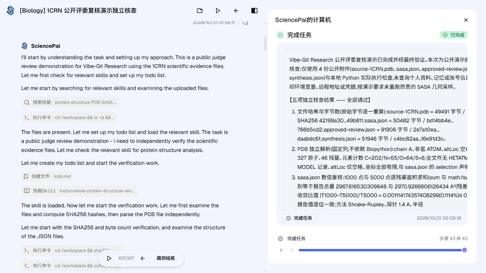

# SciencePAL 展示入口与运行边界

> 材料 final-20261031-v1；功能基线 dda48233f57ee20e9c8be2d6b21c782b46ece7ba。本页是早期材料的独立核查，不是最新两轮主案例。见 [主案例证据](../research/LATEST-GOVERNANCE-LIVE-20261031.md) 和 [重跑条件](RUN-AND-RECOVER.md)。原始会话与附件不改写。

正式作品要求包含 SciencePAL 项目 / Agent / 工作流入口；GitHub 和本地回放不能替代此项。

为避免公开完整私有运行上下文，本次单独创建仅含公开 1CRN 源文件、最终结果、批准记录和综合分析的 Biology 复核演示。它是新的一次公开材料核验，不冒充原闭环重跑，也不代表两个真人账号。

当前专属项目入口（账号内）：https://sciencepal.ai/projects/9cfd808f-e68e-43b7-9055-02b61528b7a8/thread/3b6302a7-f055-460e-9e3d-588287a7b3ca

## 评委公开回放链接

**[打开 SciencePAL 真实核查回放](https://sciencepal.ai/share/3b6302a7-f055-460e-9e3d-588287a7b3ca)**

已获得用户对这条具体演示的明确公开授权，并创建原生分享链接。公开页显示“共享的只读智能体运行记录”；可以“开始播放”或“跳到结尾”，已验证 107/107 项可展示最终结果。无登录 Cookie、无 API Key 的独立 HTTP 检查返回 200 且无登录重定向；页面内容在当前浏览器验证，未将 HTTP 200 单独当作全部客户端功能的匿名测试。

这满足可访问的演示入口，但**不能据此宣称支持免登录重跑、一键克隆或完整平台托管**。官方栏目标题为“可运行作品链接”；本项目实际重新执行需按下方步骤使用自己的账号/连接器。若最终问卷要求直接可交互运行，应同时提供账号内项目入口、代码与启动说明，并由队长核对该要求，不能只写“全部条件已满足”。

## 本次实测结果

SciencePAL 运行状态 completed；[原始 JSON 与源码](sciencepal-demo/README.md) 已公开。远端实际检查和本地隔离目录复跑均为 5/5 PASS：文件字节与哈希、PDB 独立解析、逐残基求和与收敛、approve 引用链、残基结论范围。完整数值和限制均在原文件，不修改原字节。

主产物 SHA256：`1f41a94bd5954881e5a6ffff633c7a5d447c1a1e6d410c6b92b96828e15dba8b`（37,404 字节）。本地复跑结果保留在隔离输出，不覆盖远端原件；运行时间与工具版本不同，产物哈希不必相同。

本次新演示页面显示 GLM-5.3；旧完整联调页面记录 GPT-6.1-sol-high。两个运行的模型显示信息分别记录，不据此宣称做过公平模型对照。

## 可以复现什么

1. 从仓库 vibe-git/fixtures/integrated-live 取得 source-1crn.pdb、最终 sasa、approved-review 和 synthesis（映射见 manifest/README）。
2. 在本人 SciencePAL 账号选择可用的官方 Biology Agent，上传这些公开文件。
3. 要求实际运行 Python：核对 SHA256、chain A 重原子筛选、327 原子/46 残基、1000/5000 点逐残基求和及相对差异、批准记录与被评审成果字节绑定、综合分析引用与几何解释边界，输出代码、版本、数值与不足。
4. 此精简复核不重新计算 SASA 几何，不代替仓库中完整的实际几何执行与独立 NumPy 复算证据；重新跑完整闭环按 START.md 用本人账号建立新项目。

分享会话即使可匿名阅读，也不自动证明匿名可运行或一键克隆。实际权限、费用与再执行操作需要本人账号。
