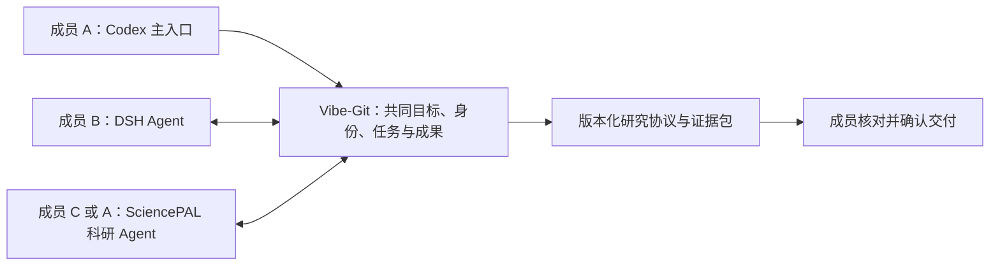

# 多人 × 多 Agent × 跨平台科研协作

**2026-10-30 更新：以 [科研流程主线决策](RESEARCH-FIRST-DECISION.md) 为准。SciencePAL 成为默认执行平台，Codex 主入口降为可选兼容入口。以下保留前一版跨平台规划背景。**

2026-10-29。本文整合用户最新方向：Codex 为主要操作入口，同时连接多位成员在 Codex、DSH 和 SciencePAL 中的 Agent；SciencePAL 必须有可观察、可验证的科研价值。Codex 调用 SciencePAL 的本地 JSON CLI 已实现，见 [统一入口](SCIENCEPAL-CODEX-ENTRY.md)；DSH 执行适配、平台无关成员绑定和结构化研究协议仍是待实现设计。

## 产品定义

**Vibe-Git 让科研团队的每个人，带着自己常用的 Agent 一起工作：SciencePAL 提供研究方案、专业工具与证据核查，Codex/DSH 完成各自分工，所有工作按同一个研究协议交接与验收。**

Codex 是本轮演示的主要入口。它代表操作者组织任务，通过 Vibe-Git 提交和查询工作；并不因此持有队友账号、绕过队友授权，或获得替别人修改提案的权限。

这是三个相互独立的维度：成员是谁、工作由哪个 Agent 负责、Agent 在什么平台运行。底层模型是额外信息；两个平台使用同一模型不能宣称模型独立性。

## SciencePAL 的价值要在哪里出现

不能只在演示末尾调用一次 SciencePAL 生成说明文字，也不能通过人为限制“所有按钮必须经过它”制造优势。

优先验证以下价值：

| 价值 | 官方材料支持到什么程度 | 在产品里必须留下什么证据 |
| --- | --- | --- |
| 科研工具与准备好的领域环境 | 官方描述领域沙箱、蛋白相关 ChimeraX/PyMOL/BioPython/MDAnalysis，以及材料相关 Quantum ESPRESSO/LAMMPS；不是本账号实测结果 | 当前 Agent 实际可用工具、版本、真实命令、输入输出和失败记录；探测成功才纳入演示 |
| 研究上下文与方法积累 | 官方描述 Skills、Memory、持久化环境和跨会话资料 | 本项目引用了哪份方法说明/技能版本，怎样影响研究协议；不得默认导出个人记忆或整库共享 |
| 文献与学术资料工作流 | 官方描述参考文献管理、引文网络和文档解析 | 主张对应的来源、定位、适用范围；无法核实的引用标为未核实 |
| 科研团队角色 | 官方已有统计、文献和代码评审的多 Agent 团队 | 科研评审实际读了哪些文件、提出何种可复核问题、为何影响下游结果 |

主要来源：[产品介绍](https://sciencepal.ai/blogs/sciencepal2intro)、[执行与专业工具说明](https://sciencepal.ai/blogs/how-ai-does-science)、[使用指南](https://sciencepal.ai/help)、[发布会说明](https://sciencepal.ai/blogs/launch-recap)。这些支持平台能力描述，不构成 SciencePAL 比 Codex/DSH 更强的比较试验证据。

目标表述是“科学方法、专用工具和团队研究资产在这里形成可复用价值”，不能承诺“换任何其他 Agent 都不可能做到”。替代成本、正确率和省下的人工步骤须实际测量。

## 分工与同一条工作链

1. **成员提出研究目标。** A 在 Codex 发起项目，B 用自己的 DSH 提交负责部分；双方提案归属独立。
2. **SciencePAL 形成研究协议。** 指明问题、数据/文献依据、方法、假设、控制实验、验收标准和不能下的结论；不确定内容明确列出。成员确认后冻结。
3. **Codex 组织实现。** 根据协议生成任务包，处理本地代码、测试及结果集成；不能私自弱化科研验收。
4. **其他成员的 Agent 执行分工。** DSH 可承担数据整理、另一条实现或复现任务。这里是演示中的角色分配，不是已证明 DSH 天生更擅长这些任务。
5. **SciencePAL 实质执行科研检查。** 使用实际可用的专业工具或资料，对原始结果复算/核查，逐项评审；报告须引用任务文件和具体观察。
6. **有证据的返工。** 若发现问题，指出受影响的任务或结论，生成明确反馈；执行成员修订后重新交接，旧版本保留。
7. **双重验收。** 工程测试、科研评审分别展示。科研流程在两类检查通过后提交成员确认，无法判断的事项不能记为通过。

最终人的确认权属于成员和队长。科研评审可以建议阻止交付，但不能把 Agent 的批准当作独立的科学认证。

## 怎样做出有说服力的 Demo

现有求和和 Iris 流程继续用作交接与协议回归测试；它们不足以展示 SciencePAL 的领域优势。

**优先候选：公开结构文件的质量检查与有限范围的结构分析。** 先让 SciencePAL 探测选定 Agent 是否具备所需专业工具；再选一个公开、可合法使用的小数据样本，固定输入版本。SciencePAL 给出分析协议并产生专业工具输出，Codex 构建可复现执行与可视化，另一成员用 DSH 完成独立结果整理/复算。专业结果必须让有相应领域经验的队员核对；不能从结构分析直接夸大到药效、临床或新发现。

当前已选公开 1CRN 结构做有限几何复算，见 [案例与实际工具探测](fixtures/structure-case/README.md)。本次探测的自定义 Agent 沙箱缺少 BioPython、PyMOL 等专用包，因此采用已存在的 NumPy 和本地独立基线，验证单位核查、数值复算与返工。不能将此结果推广到 SciencePAL 所有领域环境，也不能将通用计算包装成已证实的平台专属优势；当前结果不覆盖结构预测、药效或机制研究。

演示故障可以是预先声明的受控测试，例如输入单位、过滤规则或方法假设被改变。错误需真实注入并通过实际输出被检测；不事后篡改文件，不把脚本安排的退回伪称 Agent 自发发现。

## 统一接口如何衔接现有代码

现有 SciencePAL 成员模型暂时是“一位成员绑定一个 SciencePAL Agent”。下一步需从平台专用身份改为稳定的 `agentBindingId`，其成员 ID、平台、外部 Agent 引用分别保存。

最小操作集合（本地 CLI 已覆盖下面的基本动作，尚未注册为 MCP 工具；团队授权绑定接口仍待统一）：

- `agents.list`：只列操作者在当前团队有权委派的 Agent 绑定及已验证能力。
- `tasks.submit`：指定 Agent 绑定、研究协议版本、目标与实际输入文件，返回持久任务 ID。
- `tasks.status`：查询原任务，显示运行中、等待输入、失败、结果未知、已完成等真实状态。
- `tasks.collect`：接回真实成果与来源记录，不自动覆盖工作区代码。
- `tasks.respond`：对同一任务补充说明或反馈返工，避免新开无关会话冒充续接。

Codex 主入口先通过可调用的本地 CLI 使用这些操作；DSH 接入优先采用它已有的正式 CLI/插件能力。完整的 MCP 包装可以在公共接口稳定后增加，不能先堆三种平台入口而底层仍是三份不同协议。

接入差异保留在各平台适配器里。没有可靠取消/续接/状态查询能力的平台必须明确报告不支持，不能伪造一致性。跨成员的任务经过所属成员连接器；平台 Key 不传给主控 Codex 或 Host。

继续复用原有身份、提案权限、冻结文件、要求版本、防重日志、评审、返工和历史证据。新增研究协议与证据来源应在同一任务链中引用，避免再建立一套独立科研项目数据库。

## 科研价值怎样验收

对同一任务、同一输入、同一人工判定标准，做三组有限对照：

1. Codex 单独完成，允许其合理使用工具与已有技能。
2. SciencePAL 原生完成，允许使用其原生团队和文件能力。
3. 多成员跨平台流程：Codex 主入口 + 队友 Agent + SciencePAL 科研环节。

记录：实际工具成功率、已知问题检出率及误报、引用能否核实、结果能否复算、人工复制/协调次数、配置时间、总耗时与可观察的运行成本。第一轮是探索性验证，不凭一个样例宣称统计显著或全面优越。

分开回答两件事：SciencePAL 是否贡献了专业价值？Vibe-Git 是否降低了多成员跨平台协作负担？不能拿一者的效果代替另一者的证据。

## 实施顺序与完成定义

**第一步：Codex ↔ SciencePAL 统一入口。** 先让用户一句话触发真实任务，能查询、接回、核对并反馈；Key 保持本地，未知提交不重发。选择并验证一项 SciencePAL 专业能力。完成前不能声称“科研工具已接入”。

**第二步：将 Agent 绑定与任务包改为平台无关。** 保留当前 SciencePAL 项目兼容性，迁移有版本标记；同一平台 Agent 在不同成员下是两个授权绑定。权限测试覆盖跨成员冒领、共享 Agent 与版本过期。

**第三步：第二位真实成员用 DSH 加入。** 探测正式支持的接口后接入；若只能人工导入任务包，界面必须写明人工接力，不能声称自动跨平台协作。

**第四步：完成一个可核验的科研案例及上述对照。** 录制真实的研究方案—实现—专业检查—返工—修订链条；展示使用的工具和数据，不只展示平台 Logo。

当前已有：原 Codex 多人控制面；SciencePAL HTTP 客户端与真实同账号运行证据；成员连接器与权限流程；真实单成员绑定；Codex 可调用的 `sciencepal:call` 统一入口，包含持久防重、文件采集和原线程返工。89 项 SciencePAL 专项测试及完整构建、类型检查通过。当前未完成：三平台统一执行入口、DSH 任务适配、第二真实成员联调、SciencePAL 专业优势公平对照。单账号 CLI 不自动获得团队项目批准权。

## DSH 复用核查

查询：`gh search repos 'dsh-codex-connect in:name' --limit 3`。初次沙箱网络失败后，经已有本地代理只读重试成功；没有修改代理设置。

最强候选：[franksong2702/dsh-codex-connect](https://github.com/franksong2702/dsh-codex-connect)。Apache-2.0，未归档，最后推送 2026-10-29。已查看 README 和 package.json：它将 Codex 模型提供方接入 DSH 的执行循环，并不是连接两个独立 Agent 会话的协作协议。直接运行依赖含 schemastery、pi-ai、undici，且有较多绑定 DSH 精确版本的 peer dependencies；README 区分已发布版本与未发布兼容候选。

决策：**仅作架构边界参考，不安装、不复制实现、不作为本项目跨平台任务桥。** Apache-2.0 允许按条款复用，但当前目标不匹配，不增加这组依赖。其他搜索结果是同类插件衍生仓库，未进一步采用。DSH Desktop 在本机存在，但本次未确认可用的 DSH CLI/任务接口，不能把已安装桌面应用等同于已具备自动调用能力。
